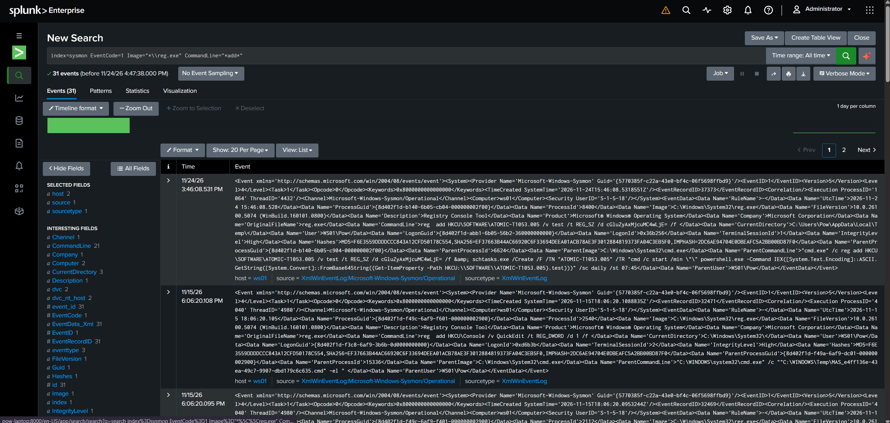
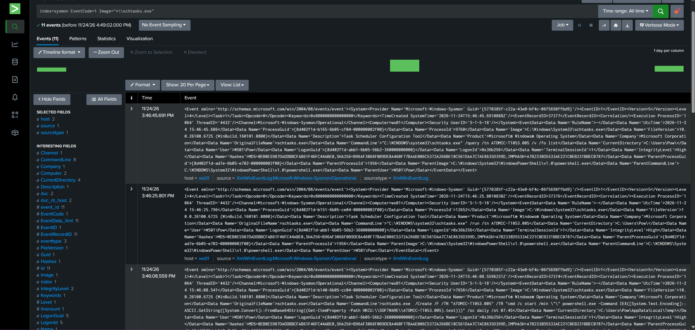
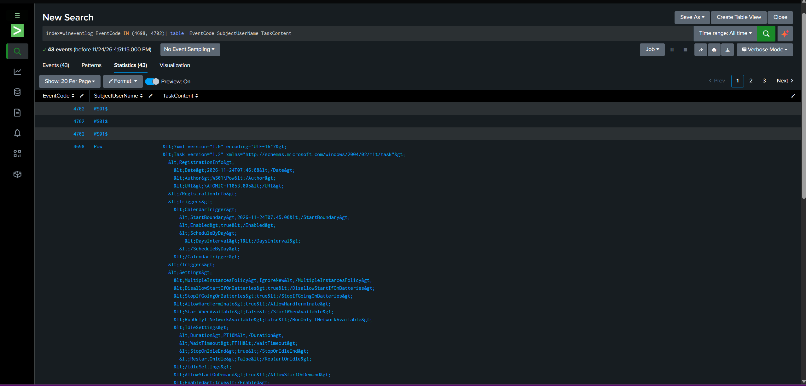
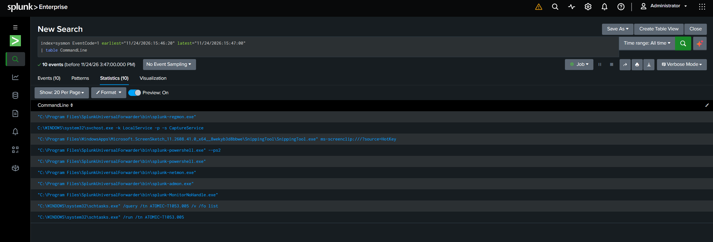
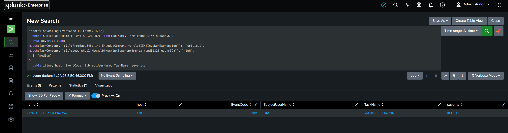

# Scenario S2: Scheduled Task/Job: Scheduled Task (T1053.005)

## 1. Scenario Metadata
- **MITRE ATT&CK:** T1053.005 — Scheduled Task/Job: Scheduled Task
- **Date / Time (UTC):** `2026-11-24 15:46:08 UTC` (task creation) and `2026-11-24 15:46:25 UTC` (manual trigger attempt via `schtasks.exe /run /tn ATOMIC-T1053.005`)
- **Compromised User:** `Pow`
- **Target Host:** `ws01` (`10.10.10.30`)
- **Log Sources Analyzed:** `index=wineventlog` (Windows Security Log) and `index=sysmon` (`Microsoft-Windows-Sysmon/Operational`)

---

## 2. Executive Summary

On `2026-11-24` at `15:46:08 UTC`, a scheduled task (`\ATOMIC-T1053.005`) was created by the local administrator account `Pow`, generating Windows Security `EventCode=4698`. At `15:46:25 UTC`, the task was manually triggered via `schtasks.exe /run /tn ATOMIC-T1053.005`.

The task was configured to run a PowerShell `IEX` command that decodes and executes a Base64-encoded payload staged in `HKCU\SOFTWARE\ATOMIC-T1053.005`. Although both the task creation and manual trigger events were recorded in telemetry, Sysmon process monitoring confirmed that the child payload never spawned.

---

## 3. Attack Timeline & Telemetry Analysis

### Audit Policy & Baseline (Pre-Execution)
- To generate scheduled task lifecycle events (`EventCode` `4698`–`4702`), the **Other Object Access Events** audit subcategory was enabled via PowerShell:
  ```powershell
  auditpol.exe /set /subcategory:"Other Object Access Events" /success:enable
  ```
- Pre-execution baseline analysis identified **39 benign events** in `index=wineventlog`, all `EventCode=4702` (task updated) generated by the local machine account (`WS01$`)—22 of which belonged to `\Microsoft\Windows\UpdateOrchestrator\Schedule Work`. Zero baseline `EventCode=4698` creations or `schtasks.exe` executions occurred prior to the test.

### Stage 1: Registry Payload Staging (`15:46:08 UTC`)
```spl
index=sysmon EventCode=1 Image="*\\reg.exe" CommandLine="*add*"
```


- **Key Artifacts Observed:**
  - **Image:** `C:\Windows\System32\reg.exe`
  - **ParentImage:** `C:\Windows\System32\cmd.exe`
  - **CommandLine:** `reg add HKCU\SOFTWARE\ATOMIC-T1053.005 /v test /t REG_SZ /d cGluZyAxMjcuMC4wLjE= /f`
  - **Decoded Payload:** `cGluZyAxMjcuMC4wLjE=` decodes from Base64 to `ping 127.0.0.1`.

### Stage 2: Scheduled Task Registration (`15:46:08 UTC`)
```spl
index=sysmon EventCode=1 Image="*\\schtasks.exe"
```
```spl
index=wineventlog EventCode IN (4698, 4702)
```



- **Key Artifacts Observed:**
  - **EventCode:** `4698` (A scheduled task was created)
  - **SubjectUserName:** `Pow`
  - **TaskName:** `\ATOMIC-T1053.005`
  - **TaskContent (XML):** Configured a daily `07:45` `CalendarTrigger` under `InteractiveToken` executing `<Command>cmd</Command>` with `<Arguments>` invoking PowerShell `IEX` and `FromBase64String` against `HKCU:\SOFTWARE\ATOMIC-T1053.005`.
  - **Sysmon `CommandLine`:** `schtasks.exe /Create /F /TN "ATOMIC-T1053.005" /TR "cmd /c start /min \"\" powershell.exe -Command IEX([System.Text.Encoding]::ASCII.GetString([System.Convert]::FromBase64String((Get-ItemProperty -Path HKCU:\\SOFTWARE\\ATOMIC-T1053.005).test)))" /sc daily /st 07:45`

### Stage 3: Manual Trigger & Execution Window Analysis (`15:46:25 UTC`)
```spl
index=sysmon EventCode=1 earliest="11/24/2026:15:46:20" latest="11/24/2026:15:47:00"
```


- **Key Findings:**
  - At `15:46:25.801 UTC`, `schtasks.exe /run /tn ATOMIC-T1053.005` executed, followed by `schtasks.exe /query` at `15:46:45.691 UTC`.
  - However, no child `cmd.exe`, `powershell.exe`, or `ping.exe` processes spawned afterward. This demonstrates why detections for `T1053.005` must anchor on **task registration (`EventCode=4698`)** rather than waiting for downstream payload execution.

---

## 4. Detection Rule & Validation

```spl
index=wineventlog EventCode IN (4698, 4702)
| where SubjectUserName !="WS01$" AND NOT like(TaskName, "\\Microsoft\\Windows\\%")
| eval severity=case(
    match(TaskContent, "(?i)(FromBase64String|EncodedCommand|-enc\b|IEX|Invoke-Expression)"), "critical",
    match(TaskContent, "(?i)(powershell|\bcmd\b|wscript|cscript|mshta|rundll32|regsvr32)"), "high",
    1=1, "medium"
)
| table _time, host, EventCode, SubjectUserName, TaskName, severity
```



- **Detection Logic:** Baseline analysis showed that routine scheduled task activity is generated by the local machine account (`WS01$`) updating built-in tasks under `\Microsoft\Windows\*`. Filtering out `SubjectUserName != "WS01$"` and `NOT like(TaskName, "\\Microsoft\\Windows\\%")` suppresses routine OS maintenance while catching any user or service account creating or modifying non-Microsoft tasks.
- **Severity Scoring:** Evaluates `TaskContent` with regex patterns to classify obfuscated or in-memory execution (`FromBase64String`, `EncodedCommand`, `-enc`, `IEX`) as `critical`, native script/LOLBin execution (`powershell`, `cmd`, `mshta`, `rundll32`, `regsvr32`, `wscript`, `cscript`) as `high`, and all other non-Microsoft tasks as `medium`.
- **Validation Results:** `1` True Positive (`\ATOMIC-T1053.005`, classified as `critical`) and `0` False Positives across `All Time`.

---

## 5. Cleanup & Hardening

To remove the persistence artifacts from `ws01`, the Atomic Red Team cleanup command was executed:

```powershell
Invoke-AtomicTest T1053.005 -TestNumbers 7 -Cleanup
```

- **Verification:** Confirmed deletion of scheduled task `\ATOMIC-T1053.005` (`EventCode=4699`) and removal of the staged registry key `HKCU\SOFTWARE\ATOMIC-T1053.005` on `ws01`.
- **Hardening Recommendations:**
  - Restrict scheduled task creation permissions to authorized administrative accounts.
  - Enable the `Microsoft-Windows-TaskScheduler/Operational` event log (`wevtutil sl Microsoft-Windows-TaskScheduler/Operational /e:true`) to gain execution-level visibility (`EventCode` `100`, `102`, `200`, `201`) alongside Security `4698` creation events.